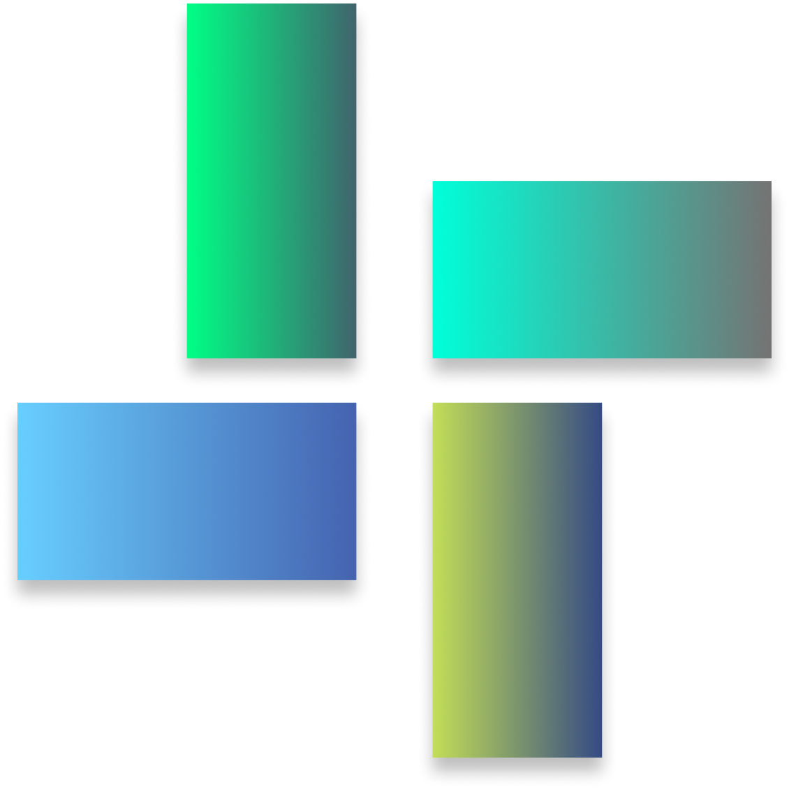

<div align="center">



# Hyggshi OS

**A modern, customizable Linux distribution built on Debian, Ubuntu, Linux Mint, Arch Linux, Alpine, and Fedora**

[](https://github.com/Hyggshi-OS-Research-Technology/Hyggshi-OS/actions/workflows/Build-Hyggshi-OS-ISO.yml)
[](https://github.com/Hyggshi-OS-Research-Technology/Hyggshi-OS/actions/workflows/pr-check.yml)
[](https://hyggshi-os-website.pages.dev)
[](https://sourceforge.net/projects/hyggshi-os/files/)
[](LICENSE)

</div>

---

## Overview

**Hyggshi OS** is an independent, customized Linux distribution engineered with a modern, cloud-first build pipeline utilizing **debootstrap + mksquashfs + xorriso** (no heavy legacy tools like `live-build`). 

> **Important**: Hyggshi OS ISO images are produced entirely in the cloud via **GitHub Actions**. There is no requirement to execute local build scripts (`.sh`). Every commit and workflow dispatch triggers reproducible, clean, isolated runner environments.

---

## Key Highlights

- 🖥️ **Multiple Desktop Environments**: XFCE, KDE Plasma, LXQt, GNOME, MATE, Cinnamon, and HDE (Hyggshi Desktop Environment powered by NexWM).
- 🐧 **Versatile Base Distributions**: Debian (Testing, Trixie, Bookworm), Ubuntu (Noble 24.04, Resolute 26.04), Linux Mint (22, 22.3), Arch Linux, Fedora, and Alpine.
- 🎨 **Hyggshi Ecosystem**:
  - **Hyggshi Welcome**: A Qt6 onboarding wizard with slide presentations and theme selection.
  - **Hyggshi Theme Daemon & Auto Theme**: Real-time or timed scheduling for automatic Dark/Light wallpaper and GTK theme transitions.
  - **Hyggshi Sound Shortcut**: Global media key grabber with customized volume OSD popup.
  - **NexWM / HDE**: Native standalone desktop session built from source.
- 🔒 **Full UEFI Secure Boot Chain of Trust**: Official Microsoft-signed `shim` integration paired with signed GRUB and kernel binaries for out-of-the-box boot on Dell, Lenovo, HP, ASUS, and Acer hardware.
- 🌐 **Internationalization & Input Methods**: Native Vietnamese input integration via Fcitx5 (Lotus / Unikey) pre-configured with complete environment modules.
- ⚙️ **Declarative Build Engine (HCL)**: INI-like domain-specific configuration language ([`iso-config/config/config.ini`](iso-config/config/config.ini)) validated by [`tools/hcl_parser.py`](tools/hcl_parser.py).
- 🏭 **OEM & Matrix Capabilities**: Single-trigger parallel matrix builds for all DEs and bases with dedicated OEM pre-installation modes.

---

## Building on GitHub Actions

Hyggshi OS utilizes GitHub Actions runners (`ubuntu-latest` and native containers) to construct bootable hybrid ISOs.

### How to Trigger an ISO Build

1. Navigate to the **Actions** tab on GitHub.
2. Select the **"Build Hyggshi OS ISO"** workflow in the sidebar.
3. Click **"Run workflow"** and customize the parameters:

| Parameter | Description | Default |
|---|---|---|
| `distro` | Base distribution: `auto`, `all`, `debian`, `ubuntu`, `linuxmint`, `alpine`, `arch`, `fedora` | `auto` |
| `desktop` | Desktop environment: `auto`, `all`, `xfce`, `kde`, `lxqt`, `gnome`, `mate`, `cinnamon`, `hde` | `auto` |
| `hyggshi_version` | Custom Hyggshi OS release version (e.g., `1.4.2`, `2.0`) | `1.0` |
| `hyggshi_codename` | Custom distribution codename (empty = auto-selected) | _(auto)_ |
| `edition` | Kernel and sysctl tuning profile: `normal`, `developer`, `server`, `lite` | `normal` |
| `debian_version` | Debian codename (when `distro=debian`): `trixie`, `bookworm`, `bullseye`, `testing` | `trixie` |
| `ubuntu_version` | Ubuntu release (when `distro=ubuntu`): `resolute`, `noble`, `jammy`, `focal` | `noble` |
| `mint_version` | Linux Mint version (when `distro=linuxmint`): `22.3`, `22`, `21.3`, `21.2` | `22` |
| `panel_style` | XFCE panel layout: `windows10`, `classic` | `windows10` |
| `icon_theme` | System icon suite: `papirus`, `numix`, `breeze`, `adwaita`, `tela` | `papirus` |
| `feature_flags` | CSV feature toggles: `browser`, `office`, `autologin`, `autoscale`, `welcome`, `theme-daemon`, `auto-theme`, `arm64`, `oem` | `browser,autologin,autoscale,welcome,auto-theme` |
| `wallpaper_url` | Direct URL for default desktop wallpaper image | _(repo asset)_ |
| `logo_url` | Direct URL for distributor and system brand logo | _(repo asset)_ |
| `plymouth_logo_url` | Direct URL for Plymouth boot animation logo | _(repo asset)_ |
| `extra_packages` | Additional APT packages separated by spaces | `""` |
| `debug_mode` | Enable verbose diagnostics and export `debug-info.txt` | `false` |

4. Once the runner finishes, the generated `.iso` and `.iso.sha256` checksums will be uploaded as build artifacts (and optionally published to SourceForge or GitHub Releases).

---

## CI/CD Pipeline Architecture

```
GitHub Actions Runner (ubuntu-latest / container)
│
├── 1. matrix-prep
│      └── Parse iso-config/config/config.ini via tools/hcl_parser.py
│          └── Generate Cartesian Matrix: [distro] × [desktop] × [oem]
│
└── 2. build-iso [Parallel Matrix Jobs]
       ├── Set up QEMU (if cross-compiling for arm64)
       ├── Restore Debootstrap & APT package cache
       ├── scripts/build.sh -> scripts/distros/build-${BASE_DISTRO}.sh
       │   └── Bootstrap minimal base rootfs into chroot
       ├── scripts/desktop.sh (Executed inside chroot)
       │   ├── Configure Debian frontend & path exclusions
       │   ├── Install Linux Kernel, initramfs-tools, Plymouth, NetworkManager
       │   ├── Install Desktop Environment packages & display manager
       │   ├── Install Calamares installer + slideshow modules
       │   ├── Apply GNOME / Cinnamon first-login configurations & Tela theme
       │   ├── Install Fcitx5 input engine & environment variables
       │   ├── Create live session user & secure sudoers permissions
       │   └── Configure zram swap & sysctl kernel tuning profiles
       ├── scripts/install-ecosystem-for-hyggshi.sh
       │   └── Extract and configure nexfetch, nexcode, etc.
       ├── app-for-hyggshi/welcome.sh
       │   └── Compile and install Hyggshi Welcome (Qt6, CMake)
       ├── scripts/make-auto-theme.sh & auto-theme.sh
       │   └── Install Hyggshi Auto Theme service and timer
       ├── scripts/branding.sh
       │   └── Deploy wallpapers, icons, os-release, hostname, and XFCE panel layouts
       ├── scripts/plymouth.sh
       │   └── Generate Plymouth boot splash theme and update initramfs
       └── scripts/iso.sh
           ├── Sanitize and unmount virtual filesystems
           ├── Compress squashfs (zstd level 19 or xz)
           ├── Assemble UEFI Secure Boot ESP with Microsoft-signed shim
           ├── Generate hybrid bootable ISO image via xorriso
           └── Compute SHA-256 integrity checksums
```

---

## Declarative Configuration (HCL)

The Hyggshi Configuration Language (HCL) in [`iso-config/config/config.ini`](iso-config/config/config.ini) drives the entire distribution build. Key sections include:

- **`[Base]`**: Select the active base distribution or enable `Build-all-base-github-actions = true`.
- **`[OEM]`**: Toggle OEM pre-installation mode or build both standard and OEM variants.
- **`[Architecture]`**: Target hardware architecture (`amd64`, `arm64`).
- **`[Desktop-Environment]`**: Specify default desktops, parallel build targets, and custom desktop overrides.
- **`[config-setup-postpartum-care]`**: Timezone, language, XFCE panel style, Cinnamon workspace layouts, and squashfs compression settings.
- **`[package.*]`**: Declarative lists of packages grouped by desktop environment or system role.
- **`[removals]`**: Packages and stock branding elements purged from the base image.

### CLI Diagnostics Tooling

```bash
# Validate HCL syntax and resolve configuration without building
python3 tools/hcl_parser.py --strict iso-config/config/config.ini --root .

# Export matrix JSON for desktop environments
python3 tools/hcl_parser.py --print-matrix-json iso-config/config/config.ini --root .

# Interactive terminal UI viewer
python3 tools/hcl_debug_viewer.py iso-config/config/config.ini
```

---

## Desktop Environments & Display Managers

| Desktop Environment | Supported Bases | Display Manager | Default Configuration & Notes |
|---|---|---|---|
| **XFCE** | Debian, Ubuntu, Mint, Arch | LightDM | Windows 10 style taskbar, Whisker Menu, Papirus/Tela icons, Skeuos dark theme |
| **KDE Plasma** | Debian, Ubuntu, Arch | SDDM | Modern Plasma workspace with optimized session defaults (Plasma 6 on Arch) |
| **LXQt** | Debian, Ubuntu, Arch | SDDM | Ultra-lightweight Qt desktop with clean memory footprint |
| **GNOME** | Debian, Ubuntu, Arch | GDM3 / GDM | Modern GNOME Shell with automated first-login extension installer |
| **MATE** | Debian, Ubuntu, Arch | LightDM | Traditional desktop experience with Caja and customized panel |
| **Cinnamon** | Debian, Ubuntu, Mint, Arch | LightDM | Tela icon suite, Orchis theme, and 4 pre-configured virtual workspaces |
| **HDE (NexWM)** | Debian | LightDM | Custom lightweight Hyggshi Desktop Environment built directly from source |

---

## Arch Linux Edition

Hyggshi OS includes first-class support for **Arch Linux**:

- **GitHub Actions Native Container**: Built in an `archlinux:latest` container using official `mkarchiso` with `--privileged` capabilities.
- **Dynamic DE Selection**: Automatically builds the chosen desktop environment (KDE Plasma, XFCE, GNOME, LXQt, MATE, Cinnamon) with customized branding, user session, and `zram-generator` swap.
- **Dedicated Archiso Profile (`scripts/Arch-folder/`)**:
  - **KDE Plasma 6 + SDDM**: Tokyo Night aesthetic with Hyggshi Dark / Light color schemes.
  - **Custom PKGBUILDs**: Pre-packaged `hyggshi-branding`, `hyggshi-os-release`, `hyggshi-tools`, and `hyggshi-welcome`.
  - **Calamares Installer**: Full GUI installer integration.
  - **Hardware Diagnostics**: `hyggshi-hardware` script for automated CPU microcode, GPU, audio, and network detection.
  - **Secure Boot Pipeline**: Standalone toolset for signing with Microsoft-signed `shim`, injecting keys, automated `sbverify`, and QEMU test harness.
  - See [`scripts/Arch-folder/README.md`](scripts/Arch-folder/README.md) for architecture and local build details.

---

## Live Session vs. Installed System Security

Hyggshi OS provides a seamless live trial experience while strictly adhering to system security after installation:

| Feature | Live Media (USB/DVD) | Installed System (Post-Calamares) |
|---|---|---|
| **Display Login** | Automatic login to desktop session | Disabled (`users.conf` sets `doAutologin: false`) |
| **Authentication** | Passwordless sudo for live testing | Real user account created in Calamares with mandatory password |
| **Live User Cleanup** | Default user `hyggshi` active | `shellprocess@removeautologin` strips live autologin files & purges live user |
| **Installer Guard** | Single-instance lock (`flock`) prevents multiple Calamares processes | Installer shortcut and live-session tools are purged |

---

## UEFI Secure Boot Chain of Trust

Hyggshi OS implements a verifiable UEFI Secure Boot chain:

```
[UEFI BIOS Firmware]
       │
       ▼ (Trusted by Microsoft Corporation UEFI CA 2011/2023)
[BOOTX64.EFI / shimaa64.efi]  <-- Microsoft-signed shim
       │
       ▼ (Distro CA verification)
[grubx64.efi / grubaa64.efi]  <-- Distro-signed GRUB EFI binary
       │
       ▼ (Kernel signature verification)
[vmlinuz-*]                   <-- Signed Linux Kernel
```

This guarantees seamless boot on OEM machines without requiring users to disable Secure Boot in UEFI BIOS settings.

---

## Repository Structure

```
├── .github/workflows/          # CI/CD Workflows (ISO build, release, lint, PR check)
├── app-for-hyggshi/            # Hyggshi native apps (Welcome, Theme Daemon, Sound Shortcut)
│   ├── hyggshi-welcome/        # Qt6 onboarding wizard application
│   ├── hyggshi-theme/          # Auto Theme systemd service & scripts
│   └── hyggshi-extensions-sound-shortcut/ # Volume OSD daemon
├── iso-config/                 # System branding, packages, and installer configuration
│   ├── branding/               # Logos, wallpapers, and GRUB backgrounds
│   ├── calamares/              # Calamares modules, settings, and slideshow
│   ├── config/config.ini       # Declarative HCL system configuration
│   └── packages/               # Distro package lists
├── scripts/                    # Core host and chroot build scripts
│   ├── build.sh                # Distro dispatcher and dependency installer
│   ├── desktop.sh              # Desktop environment, packages, and user setup
│   ├── branding.sh             # Visual asset deployment and rebrand engine
│   ├── plymouth.sh             # Plymouth theme generation
│   ├── iso.sh                  # Squashfs creation, EFI ESP assembly, and xorriso packaging
│   └── distros/                # Base distro rootfs bootstrap scripts
└── tools/                      # HCL parser, validator, and upload utilities
```

---

## Links & Community

- 🌐 **Official Website**: [hyggshi-os-website.pages.dev](https://hyggshi-os-website.pages.dev)
- 💾 **SourceForge ISO Downloads**: [sourceforge.net/projects/hyggshi-os](https://sourceforge.net/projects/hyggshi-os/files/)
- 🐞 **Issue Tracker**: [GitHub Issues](https://github.com/Hyggshi-OS-Research-Technology/Hyggshi-OS/issues)
- 📜 **License**: Distributed under the terms in [`LICENSE`](LICENSE).
